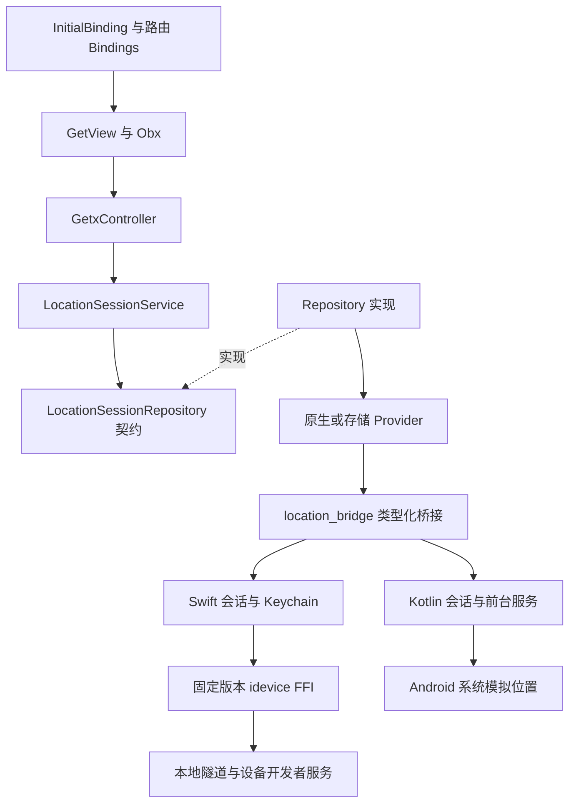

# 项目架构

本页描述项目架构，M0 已实现 Get CLI 页面、应用服务与双端原生桥接；地图等后续能力仍是目标设计。当前证据见 [实现状态](implementation-status.md)。平台依据见 [可行性研究](ios-location-feasibility.md)。按用户指定，统一使用 `get: ^4.7.3` 管理状态、路由与依赖。目录采用 GetX 官方 CLI 支持并链接的 `getx_pattern` 模块结构，再扩展原生会话所需的服务和数据边界；这是项目选择，不是 GetX 唯一强制的组织方式。[Get 4.7.3](https://pub.dev/packages/get/versions/4.7.3)、[Get CLI](https://github.com/jonataslaw/get_cli)

## 分层和数据流

定位调用路径为 `View → Controller → LocationSessionService → Repository → Provider → Bridge`；普通设置/收藏 Controller 可直接依赖自己的 Repository。Bindings 装配具体对象，状态沿相反方向更新。Repository 契约、数据模型与平台实现保持隔离，但不额外创建空的 `domain/presentation` 目录。这里的 Provider 是数据源适配器，不是状态管理框架。

| 层 | 负责 | 不承担 |
| --- | --- | --- |
| `app/bindings`、`app/routes` | 全局装配、路由表、路由绑定 | 定位协议、存储算法 |
| `app/modules` | View、Controller、局部 State、模块 Binding 与组件 | 直接访问文件和平台通道 |
| `app/services` | 应用级定位协调、只读响应式快照、初始化状态 | 接管原生协议状态机、页面布局 |
| `app/data/models`、Repository 接口 | 不可变模型、业务契约、必要的纯逻辑 | GetX、Flutter、地图或桥接生成类型 |
| `app/data` 的实现与 Provider | Repository 实现、DTO 映射、本地存储和原生适配 | Widget 布局、Get.find 全局查找 |
| `location_bridge` | 类型化 API、错误与事件、原生资源生命周期 | 页面路由、收藏、地图样式 |
| Rust 原生库 | 开发者服务连接和定位协议能力 | Flutter 状态、App 文案 |

不为简单字段读取创建 UseCase；复杂或重复的纯逻辑出现后再按需抽取，避免以框架命名代替职责划分。[Flutter 对按需分层的说明](https://docs.flutter.dev/app-architecture/guide)

## 功能模块和公开边界

| 模块 | 职责 | 主要依赖 |
| --- | --- | --- |
| `startup` | 展示初始化阶段、错误和重试；按检查结果导航 | 应用级 LocationSessionService |
| `location_workspace` | 组合选点、会话卡和操作栏 | 通过自身 Controller 调用应用服务 |
| `device_setup` | 开发者模式、配对、隧道和模拟应用选择的引导 | 应用级 LocationSessionService |
| `coordinate_picker` | 手输坐标；后续地图选点与显示 | `data/models/geo`，地图适配器 |
| `location_session` | 连接、设置、清除、恢复入口、会话快照 | 领域契约、原生桥接 |
| `favorites`（M1） | 收藏及最近选择的本地管理 | 坐标类型、本地存储 |
| `settings`（M1） | 非敏感偏好、版本与诊断入口 | Preferences、脱敏诊断 |
| `route_playback`（M2） | 路线、GPX 和播放 | 通过稳定公开接口操作定位会话，与 app/routes 导航配置区分 |

每个模块采用 `bindings/`、`controllers/`、`views/`、`widgets/`，简单模块不必创建无用目录。模块之间通过应用服务、共享契约或明确导出的纯组件协作，不互相 `Get.find` 页面 Controller。`coordinate_picker` 不知道定位服务是否连接，选点和收藏选择不会自动改位置。主工作区由 `app/modules/location_workspace/views/location_workspace_view.dart` 组合，调用自己的 Controller 发起明确定位操作。

`LocationSessionRepository` 与 `LocationSessionService extends GetxService` 为应用级实例。Service 构造注入 Repository，定位相关 Controller 构造注入 Service；其他模块 Controller 注入所需 Repository。`Get.find` 集中在 Bindings 等装配位置，View 通过 `GetView<T>.controller` 获取页面 Controller；不在 Repository 或纯模型中查找全局对象。

Service 维护私有 `Rx<SessionSnapshot>`，只对外提供快照 getter 或订阅接口；Controller 派生展示数据，不另建一套原生状态机。`Obx` 仅包裹读取响应式 getter 的必要区域，纯展示 Widget 接收普通值和回调。

## GetX 启动、路由与生命周期

统一使用 `GetMaterialApp(initialBinding: InitialBinding(), getPages: AppPages.routes)`，路由常量集中于 `app/routes/app_routes.dart`，页面与 Binding 的关系集中于 `app_pages.dart`。通过 `Get.toNamed` 等命名路由跳转，参数先校验，不传配对凭据或原生句柄。[GetX 路由和 Bindings](https://pub.dev/packages/get/versions/4.7.3)

`InitialBinding.dependencies()` 保持同步：先注册 Repository，再用 `Get.put<LocationSessionService>(..., permanent: true)` 注册全局服务。Service 的同步 `onInit()` 启动受管理的初始化 Future，捕获异常并更新 loading/error/ready，不能写成无人等待的 async void。原生 attach 尚未完成时页面显示初始化状态并禁用定位命令；不在 Binding 内等待配对或设备连接。

页面 Binding 使用 `Get.lazyPut(() => Controller(service), fenix: false)`，采用 `SmartManagement.full` 管理路由控制器。初始 `/startup` 页面在初始化完成后选择设备引导或工作区；异步能力探测放 Service/Controller，不在同步路由 redirect 中弹权限、配对或设置坐标。

页面 Controller 的 `onClose()` 释放本页 Worker、StreamSubscription、输入/动画控制器，不调用清除或销毁应用会话。Service 必须提供显式、可等待且幂等的 `shutdown()`，用于有意退出或测试清理；正常业务停止使用独立的清除命令。本轮核对的 Get 4.7.3 发布源码中，`Get.reset()` 清注册表而不负责调用异步资源清理，测试先 `await shutdown()` 再 reset。[Get 4.7.3 发布包](https://pub.dev/packages/get/versions/4.7.3)

完整操作流程见 [项目流程图](project-flow.md)，各参与者的调用顺序见 [时序图](sequence-diagrams.md)。

## 状态和事实来源

**原生会话为连接、协议命令和资源状态的权威来源。** Repository 保留其有序投影，Controller 只补充界面交互状态。用户当前选择的坐标与已经请求设置的坐标是两个字段，移动地图不能悄悄改变正在模拟的位置。

| 维度 | 首期状态示例 | 能说明什么 |
| --- | --- | --- |
| 连接 `connectionState` | disconnected / connecting / ready / lost / closing | 能否与设备服务通信 |
| 命令 `commandState` | idle / pending / sent / acknowledged / failed / cancelled / indeterminate | 某个命令的发送、可用确认及异常结果 |
| 观测 `observationState` | unknown / sampleReceived / stale / unavailable | 本 App 收到的定位样本及其新鲜度 |

`SessionSnapshot` 携带 `runtimeId`、`sessionId`、`generation`、`sequence`，排序水位与状态在同一个原生串行上下文原子获取。M0 快照中的 `operation { id, kind, state, coordinate? }` 表示最近命令，`sample` 表示最新观测；另有 `recoveryRequired`、结构化失败与能力检查结果。M0 不保存命令历史；命令目标不能作为当前生效坐标展示。样本包含时间、精度和可用时的模拟来源标记，不用一个 `isRunning` 或 `isSuccess` 表示整个系统状态。

- 隧道已连接不能说明开发者协议握手成功。
- 命令结果返回证据等级：只能证明写出时标记 `sent`，界面显示“设置请求已发送”；协议确有服务回执时才可标记 `acknowledged` 并显示“设置请求已确认”。FFI 返回无错误不能自动升级证据，更不能显示“所有 App 定位已修改”。
- 本 App 收到模拟位置，只证明本 App 的观测；第三方 App 是否采用该结果属于单独验收。
- 清除同样区分已发送和服务已确认，再独立显示位置观测结果。后续新鲜非模拟样本可作为本 App 观测证据，仍不推断全部 App 已恢复。
- 断线后是否仍模拟未知时，保留 `recoveryRequired` 和明确的恢复入口。

## 类型化原生桥接

已建立本地插件 `packages/location_bridge`，Pigeon schema 为跨语言接口唯一来源。Dart、Swift、Kotlin 生成产物随接口一起提交，生成器精确固定为 29.0.10；公开门面把生成类型转换为稳定的插件类型，App Data 层再映射为领域类型。

下表对应当前 Pigeon 接口，唯一源文件为 `packages/location_bridge/pigeons/location_api.dart`。所有操作支持返回结构化失败，不以 bool 掩盖中间状态。

| API | 输入/输出与约定 |
| --- | --- |
| `attach` | 注册事件接收并返回原生快照；App 先安装回调并暂存事件，避免订阅窗口丢事件 |
| `getCapabilities` | 平台、OS、协议能力、检查结果；前置条件区分 satisfied / missing / unknown |
| `getSnapshot` | 当前会话、最近命令、样本、恢复要求；用于启动和回前台校正 |
| `startPairing` / `respondToPairing` / `cancelPairing` | iOS 本机配对当前采用显示验证码角色；模型同时预留输入码和系统确认。交互凭据不记录，配对记录始终留在原生层 |
| `openSetup` | 类型化设置目标；只跳转系统实际支持的入口，其他步骤展示操作引导 |
| `connect` | 建立会话；成功只表示服务可调用 |
| `setLocation` | `operationId` + WGS84 坐标；返回包含 sent / acknowledged 证据等级的命令结果，不代表定位观测 |
| `clearLocation` | `operationId`；发出清除请求，区分发送与确认，保持独立的恢复观测和错误 |
| `closeSession` | 正常退出先清除再关闭；清除不明时保留恢复要求，不报告“恢复完成” |
| `detach` | 解除 Flutter 事件接收，不隐式清除原生模拟或关闭应用级会话 |

普通事件使用 `onSnapshot` 发送完整快照，包含 `runtimeId`、`sessionId`（未连接可空）、`generation`、`sequence`；命令 ID 与时间位于 `operation`，观测时间位于 `sample`。`runtimeId` 区分原生进程实例；序号在该实例内单调递增；`generation` 在停止或会话失效时递增。

`attach` 的回调注册和快照获取在原生串行上下文完成。Dart 收到返回快照后，先应用快照，再应用缓存中同实例且序号更大的事件；发现序号缺口、实例更换或未知会话时重新同步。恢复前台同样先同步快照，旧命令回调不得覆盖新会话。

固定错误字段和错误码见 [开发规范](development-standards.md)。桥接不返回原始协议字典、FFI 指针或配对私钥；普通状态 DTO 不含凭据。需要展示或输入的配对验证码通过一次性的类型化交互传递，退出即清空，不进入可回放的会话快照或历史事件缓存。配对交互使用独立回调，携带当前配对命令的 `operationId`；Flutter 按 attempt 接收，原生另用独立 token 拦截旧回调，取消、过期、终态或关闭后禁止复活。临时交互不缓存重放，热重启后可显式取消仍在进行的原生配对。

## iOS 与 Android 原生职责

| 平台 | 原生层负责 |
| --- | --- |
| iOS | 系统能力与版本探测、本机配对交互、Keychain、外部隧道与认证握手、DDI/开发者服务错误识别、串行命令、FFI 句柄释放、Core Location 观测；M0 没有持续心跳，下一次 FFI 操作检测断线 |
| Android | 运行时权限、系统定位开关与模拟应用授权检查、provider 注入循环、前台服务和停止通知、provider 移除、原生状态与位置观测 |

首期复用外部 LocalDevVPN，不实现 VPN Packet Tunnel 扩展，也不把 VPN 图标作为可定位证据。iOS 本机配对解决凭据生成，不保证设备准备、后台执行和蜂窝建连全部可用。

Swift 封装固定版本的 idevice FFI。Rust 源码提交、Cargo.lock、构建目标、工具链和产物校验值都要可追溯；真机与 Simulator slice 分别构建，编译通过不代表真机协议通过。[idevice 项目](https://github.com/jkcoxson/idevice)

插件 iOS 源码采用当前 Flutter 基线的 SwiftPM 布局，原生 XCFramework 通过包内 binary target 接入；目录和生成输出见 [目录规范](directory-structure.md)。仅当依赖需要回退时处理 CocoaPods，避免把旧 `ios/Classes` 路径直接当作当前模板约定。[Flutter SwiftPM 说明](https://docs.flutter.dev/packages-and-plugins/swift-package-manager/for-app-developers)

## 并发、停止和恢复

原生使用显式命令队列或互斥，不能仅依赖 Swift actor 的表面串行。待发送的多次坐标更新合并为最近一次。每次异步完成前检查当前 `generation` 与命令标识。

停止操作优先移除等待中的设置，并使旧结果失效；已经发出的请求若不能取消，必须在它结束后清除。清除期间设置停止屏障，旧任务不能重新入队；新的设置请求返回 `operationInProgress`，须在清除流程终结后由用户重新提交。超时不能仅解除 Dart 等待，要关闭或失效底层请求，并把结果不明的状态保留出来。

正常路径为“发清除 → 记录可得的发送/确认结果 → 有限等待并记录观测 → 释放连接”。观测等待使用可配置的 `observationTimeout`（M0 暂定 15 秒，实测后调整）；权限不足或没有新样本不能永久阻塞释放。超期保留命令证据与“恢复观测未确认”，不把两者合并为一个成功或失败。清除失败或断隧道时不把设备标记为已恢复，可建立恢复连接重试清除；原有连接的保留也必须有超时与释放策略。任何路径均不得通过重放旧设置来“恢复会话”。

进程被强制终止无法保证执行清理。新原生进程的定位效果初始为 unknown；其默认 disconnected 快照只证明本进程没有连接，不能消除上次模拟的恢复要求。原生可在受保护文件中保留带时间的未完成变更/清除记录，仅用作恢复提示；没有历史记录也不能推断已恢复。重新启动结合实际快照、新鲜观测和显式清除重新建立证据。后台、锁屏、蜂窝、强退及重启是独立待验证能力，按 [验收计划](development-roadmap.md) 记录后再更新产品能力。

## 存储、地图和扩展

内部类型统一为 `Wgs84Coordinate`。地图插件的 `LatLng` 仅出现在地图适配层，地图源提供者同时声明坐标参考系、归属文案和网络配置，数据进入领域前做显式转换。

M0 不依赖地图网络即可手工输入坐标。M1 采用 flutter_map 门面并单独配置瓦片源，搜索和路线规划不包含在地图渲染包内；供应商变更通过适配器完成。

Preferences 保存非敏感设置；有版本 JSON 文件保存收藏和后续路线。首期不引入数据库、账号服务或云同步；当前持久化不能证明原生连接仍存在。分阶段依赖与引入条件见 [三方依赖](dependencies.md)。
