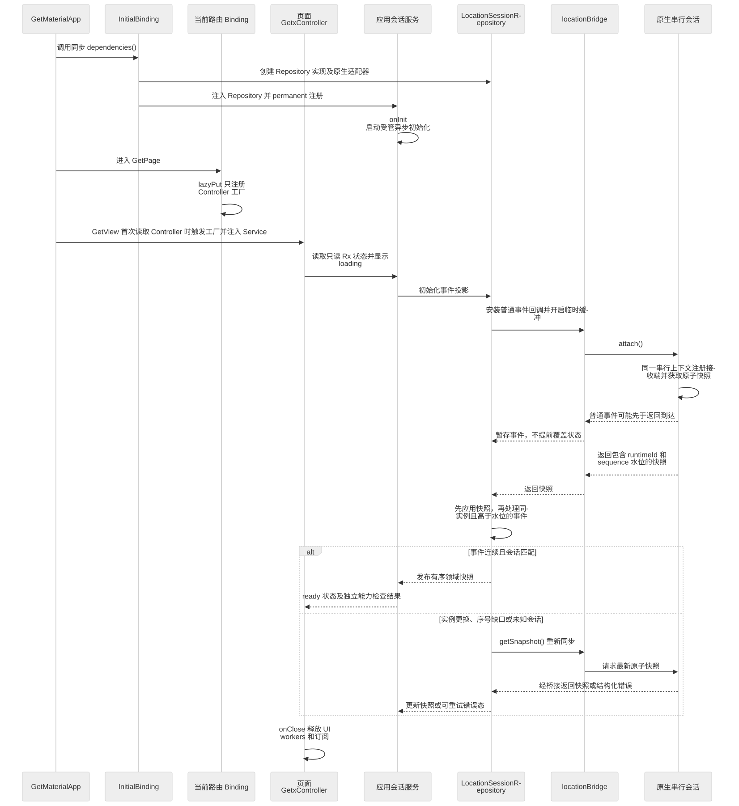
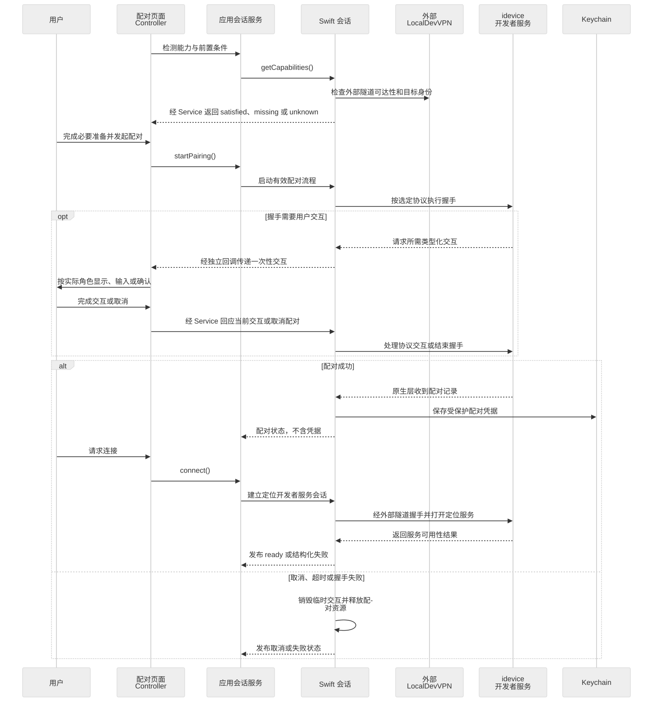
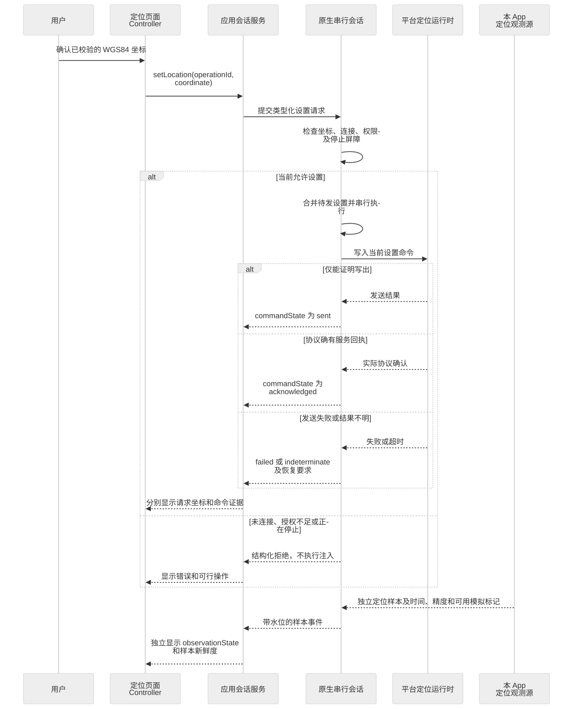
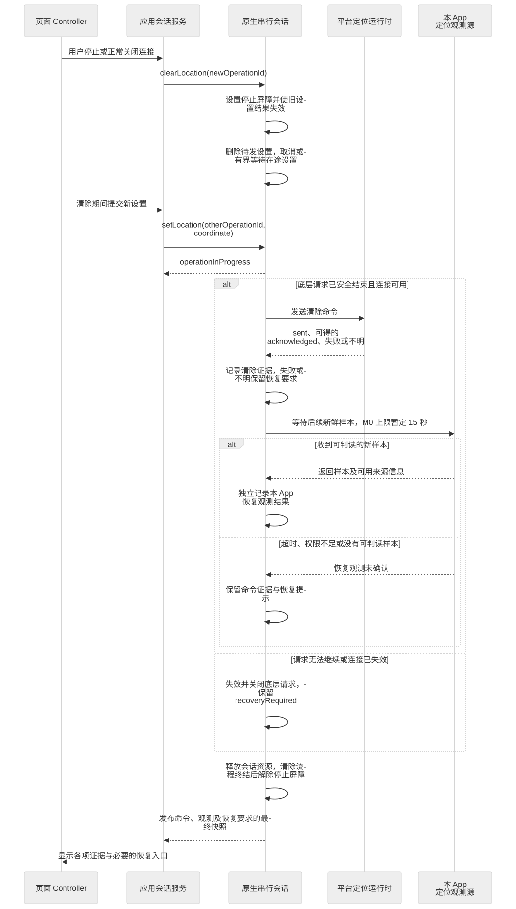
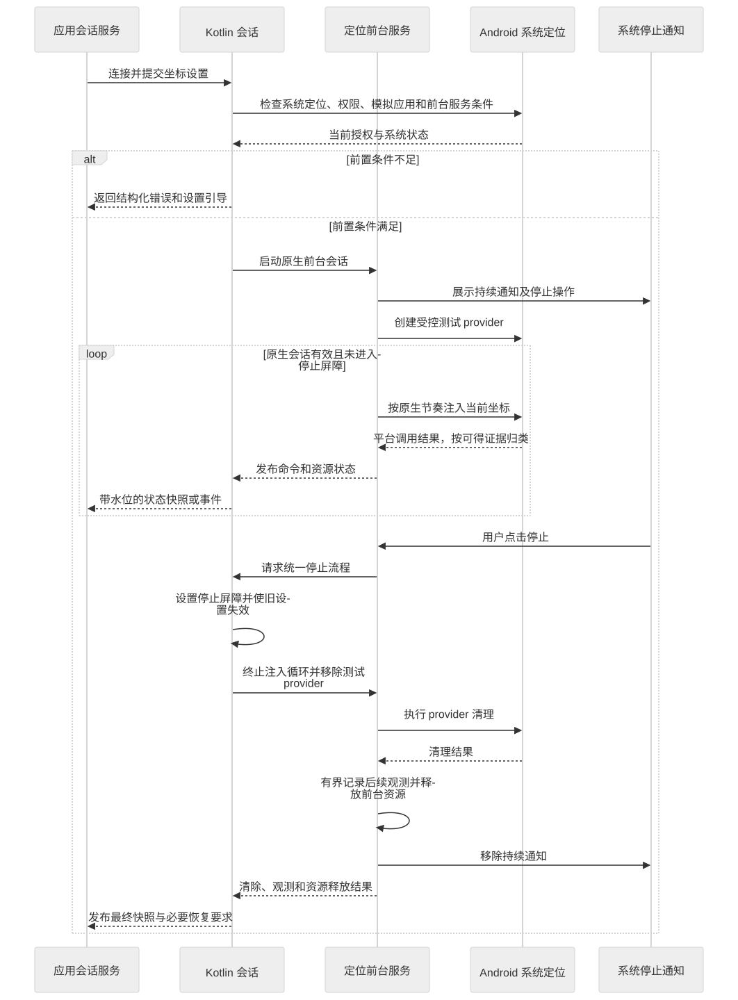

# 项目图示导出

由 Mermaid 11.17.2 从开发文档的代码块导出并完成语法与渲染校验。图中描述目标设计，尚未代表功能实现。

可编辑源码以原文档中的 Mermaid 代码块为准；修改图示时同步重新导出 SVG，不单独手改导出文件。渲染工具为临时文档工具，不是 App 依赖。

[开发文档入口](../README.md) · [流程图源码](../project-flow.md) · [时序图源码](../sequence-diagrams.md)

## 分层和数据流

[SVG 原图](architecture-01.svg) · [可编辑源码](../architecture.md)

## 应用启动与平台准备

[SVG 原图](project-flow-01.svg) · [可编辑源码](../project-flow.md)

## 单点设置、观测与恢复

[SVG 原图](project-flow-02.svg) · [可编辑源码](../project-flow.md)

## 开发阶段与出口

[SVG 原图](project-flow-03.svg) · [可编辑源码](../project-flow.md)

## 启动注册、快照与事件同步

[SVG 原图](sequence-diagrams-01.svg) · [可编辑源码](../sequence-diagrams.md)

## iOS 配对与连接

[SVG 原图](sequence-diagrams-02.svg) · [可编辑源码](../sequence-diagrams.md)

## 设置坐标与独立定位观测

[SVG 原图](sequence-diagrams-03.svg) · [可编辑源码](../sequence-diagrams.md)

## 停止优先、清除与有界恢复观测

[SVG 原图](sequence-diagrams-04.svg) · [可编辑源码](../sequence-diagrams.md)

## Android 前台服务、注入与停止通知

[SVG 原图](sequence-diagrams-05.svg) · [可编辑源码](../sequence-diagrams.md)

