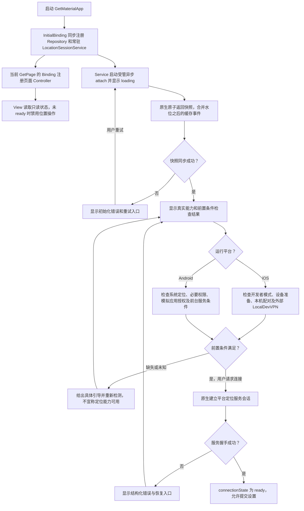
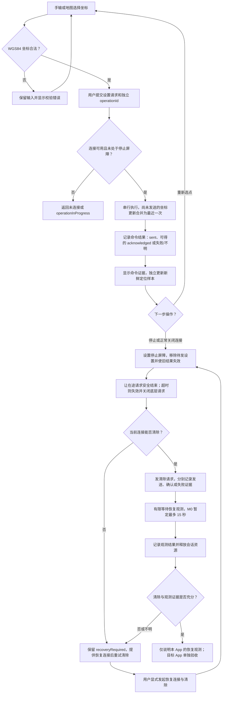
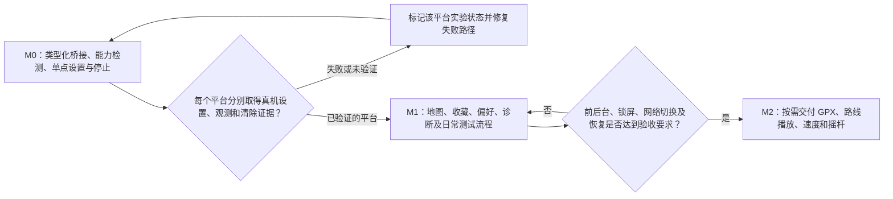

# 项目流程图

本页描述目标设计，尚未实现或完成真机验证。状态管理、依赖装配与路由使用 `get: ^4.7.3`；目录参照 [目录结构与文件分类](directory-structure.md)。状态和资源语义以 [项目架构](architecture.md) 为准，跨层消息见 [时序图](sequence-diagrams.md)，文档入口见 [开发文档总览](README.md)。

可缩放导出见 [SVG 图示预览](diagrams/README.md)。本页 Mermaid 代码块为可编辑源，更新后同步重新导出。

## 应用启动与平台准备

`InitialBinding.dependencies()` 同步注册依赖，`LocationSessionService.onInit()` 启动受管异步初始化；初始化失败进入可重试错误态，不能让未捕获的异步错误逃逸。初始化和设备连接是不同步骤，首屏无需等待用户完成配对或系统设置。

iOS 的隧道连通、本机配对和开发者服务握手分别检测；VPN 图标本身不是定位证据。配对交互角色由 M0 接入所选协议后确定。页面返回或切换路由只销毁页面 Controller 及其 UI 订阅，不清除常驻服务或原生会话。

## 单点设置、观测与恢复

设置意图、命令发送/确认和位置观测分开显示；即使命令已确认，本 App 或第三方 App 的实际位置仍需独立观察。

清除期间的新设置返回 `operationInProgress`，清除流程终结后须由用户重新提交。停止不是简单地取消 Dart Future；底层在途设置不得在停止之后继续覆盖位置。清除失败、观测超时、权限不足分别记录，等待观测不得永久阻塞资源释放。

断连或进程被强退后，定位效果可为 `unknown`，新进程的 `disconnected` 不能证明已恢复。重连只恢复通信和同步快照，不自动重放历史设置；必要时显示恢复提示并由用户显式清除。

## 开发阶段与出口

GetX 的应用装配和页面 Binding 随实际需要引入；M0 最小验证可只保留必要页面，不为路线或收藏预建空模块。每阶段的详细范围、证据等级和记录字段见 [开发阶段与验收](development-roadmap.md)。
