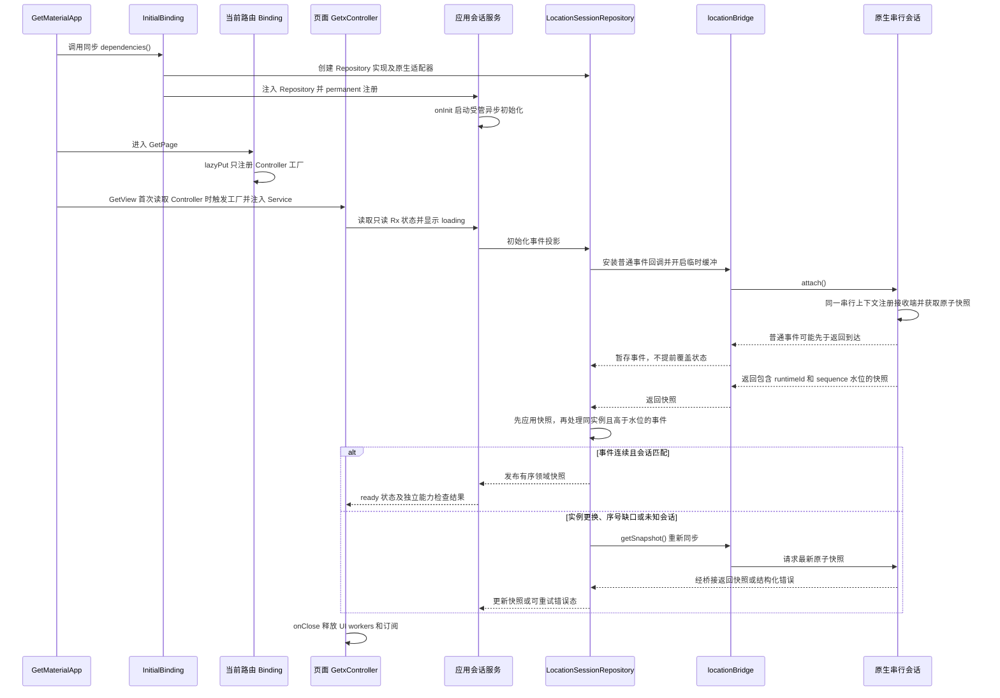
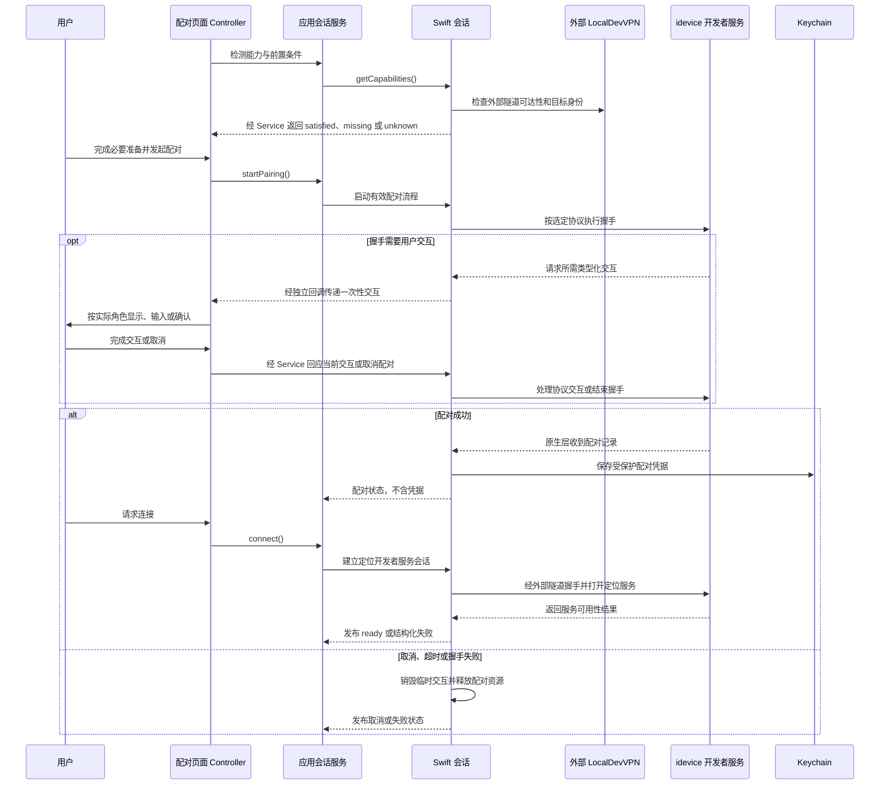
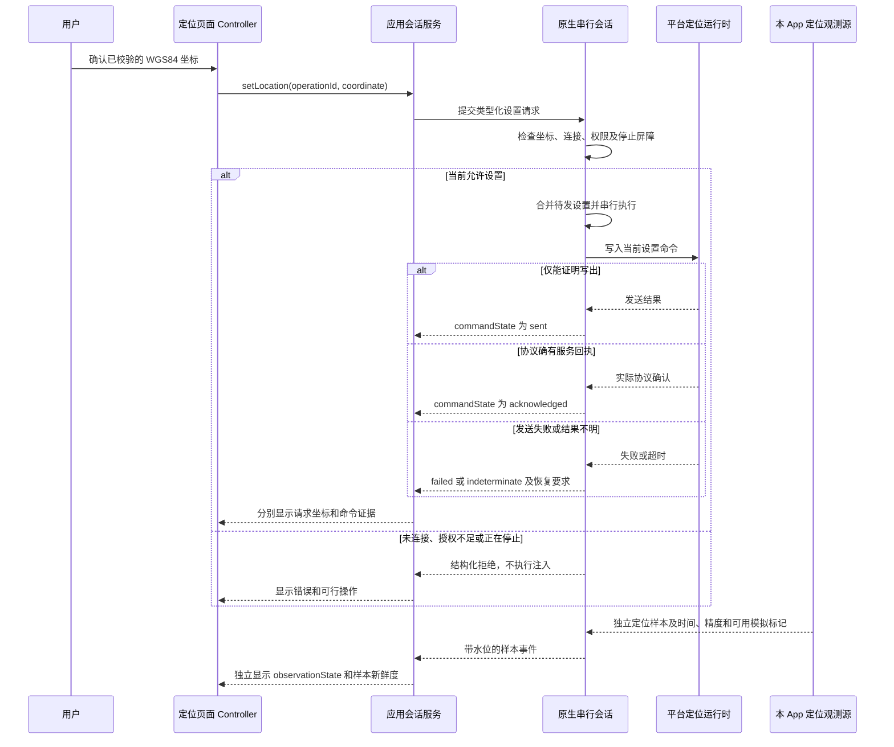
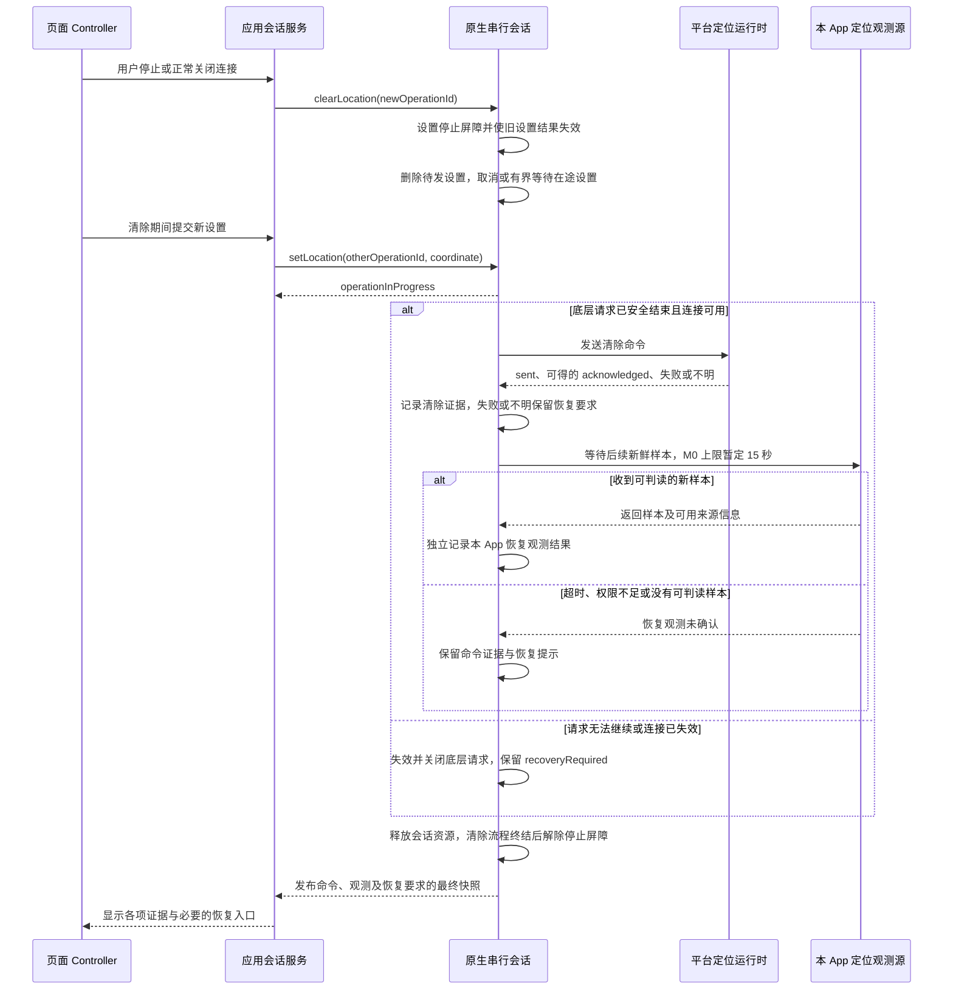
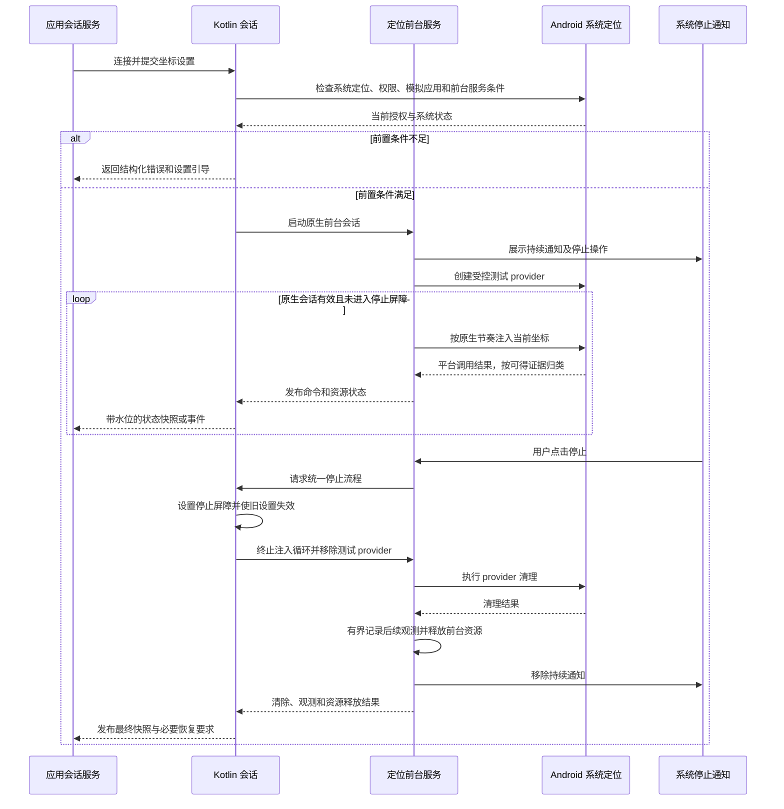

# 项目时序图

以下为目标设计，不表示已有接口实现或真机能力。所有图使用本地 Markdown Mermaid，可随代码评审同步维护；[项目流程图](project-flow.md) 展示完整业务路径，[项目架构](architecture.md) 定义接口、状态及资源约束，[目录规范](directory-structure.md) 定义文件归属，[文档总览](README.md) 为统一入口。

可缩放导出见 [SVG 图示预览](diagrams/README.md)。本页 Mermaid 代码块为可编辑源，更新后同步重新导出。

`LocationSessionService extends GetxService` 是应用级常驻会话门面，包裹 Repository 并提供只读 Rx 快照及操作。页面 Controller 由对应 `GetPage` 的 Binding 注册，并通过构造参数接收服务。后续图为保持可读性，服务与原生间的箭头省略 Repository、插件门面和 Pigeon 逐层转发；这些层仍遵守架构文档的依赖方向。

## 启动注册、快照与事件同步

`Bindings.dependencies()` 保持同步；服务在 `onInit()` 启动带错误处理、可重试的受管异步任务。View 在同步成功前保持 loading/error，不能提交位置操作。常驻服务只注册一次，页面销毁不停止原生会话。

配对交互不进入上述普通事件缓冲，不参与历史重放。实际实现中，所有跨层返回仍按桥接路径传递；图中的合并返回箭头仅用于省略转发。

## iOS 配对与连接

首期复用外部 LocalDevVPN。验证码由哪一端显示、输入或确认，取决于选定协议的实际握手角色；图只表达一次性类型化交互，不预设 PIN 方向。临时验证码退出即清空，密钥和完整配对记录始终留在原生层。

`ready` 只表示服务可调用。连接操作不重放旧的 `setLocation`；检测到上次未完成变更时保留恢复入口，提示用户显式清除。

## 设置坐标与独立定位观测

命令与样本在原生层有序发布，Repository 用 `runtimeId`、`sessionId`、`generation`、`sequence` 和 `operationId` 防止旧结果覆盖当前状态。桥接返回无错误不能自动等同于协议确认。

本 App 样本不能证明所有 App 已采用该位置。Apple Maps、独立 Core Location 测试 App 及用户关心的目标 App，按 [验收计划](development-roadmap.md) 分别记录实际行为。

## 停止优先、清除与有界恢复观测

停止必须先阻断旧设置继续生效。已经发出的请求能取消则取消，不能取消则等待其安全结束；超时必须失效或关闭底层请求，不能只让 Dart 等待结束。清除全流程受停止屏障保护。

恢复连接后只能显式重试清除，不能重放旧设置。强退无法保证本图执行，新进程必须把定位效果当作未知；受保护的未完成记录只用于恢复提示，不作为当前原生连接的证据。

## Android 前台服务、注入与停止通知

模拟应用授权、必要定位权限、系统定位和当前 Android 版本的前台服务条件均由原生校验。原生前台服务拥有 provider 和注入循环；Flutter 页面不负责用定时器维持定位。

循环中的权限撤销或 provider 错误也必须进入结构化失败与统一清理路径。App 内停止与通知停止共用原生入口；即使 Dart 事件接收端已解除，通知停止仍能触发资源清理。清除证据、后续位置样本和目标 App 验收仍分别记录。
