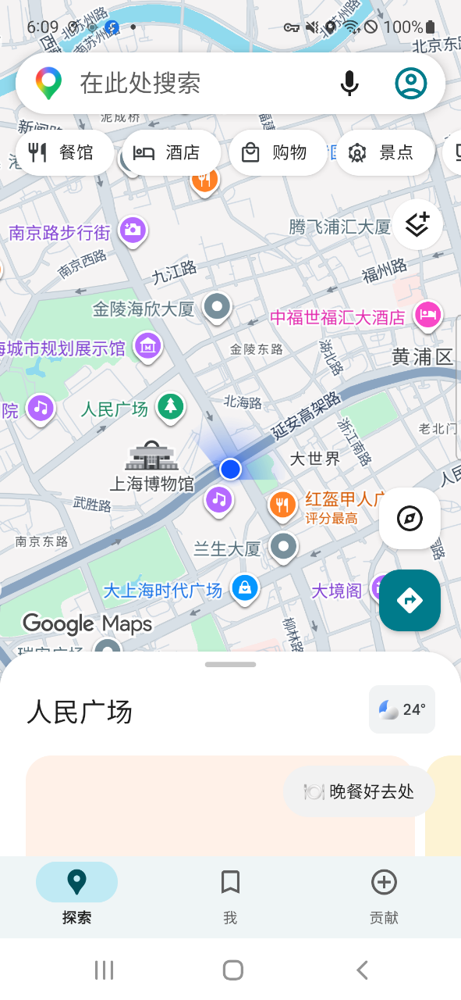
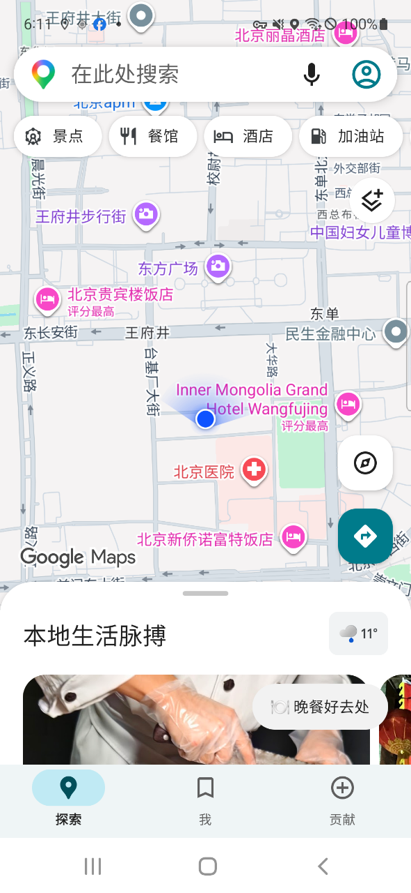

# Android 真机单点定位验证

状态：**主路径通过**。日期：2026-10-20，Asia/Shanghai；结束恢复观测约 18:18。此结论仅适用于下面的设备、系统和应用组合。

## 环境与方法

- 手机：Samsung SM-G990U2（S21 FE），Android 12 / API 31。
- 系统构建：`SP1A.210812.016.G990U2SQU1CVG1`。
- CLocation：`0.1.0+1` Debug，Flutter 3.44.2 / Dart 3.12.2。
- 独立观测应用：Google Maps `26.37.05.977222275`。
- 更新 APK SHA-256：`43f1722e6abf7b9e3ed6d0b1eb538a3b4af18ab9f68686fa2d53d7216a43d539`。
- 页面操作、权限授权、系统模拟应用选择、坐标设置、停止和地图观测均通过 **mobile_mcp**。ADB 仅用于原位更新 APK、读取系统/应用版本和只读 `dumpsys location` 交叉核对，没有通过 ADB 授予模拟 AppOp 或注入坐标。
- 精确真实坐标、设备序列号和个人账号不写入报告。下方 A/B 是公开测试坐标；恢复只记录与基线的比对结果。

## 真机发现与修复

原 APK 未声明 `android.permission.ACCESS_MOCK_LOCATION`，因此在 Samsung 的“选择模拟位置信息应用”中只看到“无”和其他既有应用，无法选择 CLocation。

在本地插件 Manifest 补齐该声明，并用 `tools:ignore="ProtectedPermissions"` 限定其用途；实际授权仍由用户在开发者选项选择，运行时检查 AppOp。宿主显示名称统一为 CLocation。重新构建、原位安装后，系统列表出现 CLocation，选择成功，连接按钮可用。

构建通过，合并 Manifest 包含该声明。[AOSP 模拟应用选择器](https://android.googlesource.com/platform/packages/apps/Settings/+/refs/heads/main/src/com/android/settings/development/MockLocationAppPreferenceController.java) 使用此声明筛选候选应用；[AOSP 对 AppOp 授权的说明](https://android.googlesource.com/platform/frameworks/base/+/f7e9cf4%5E%21/) 区分声明和实际注入授权。

## 验证结果

| 步骤 | 命令/本应用观测 | 系统独立证据 | Google Maps 观测 | 结果 |
| --- | --- | --- | --- | --- |
| 准备 | 授予“使用应用时访问精确位置”；系统定位已开启；选择 CLocation 为模拟应用 | 系统 AppOp 由设置页选择；应用前置检查允许连接 | 模拟前蓝点位于实际位置区域，作为基线 | 通过 |
| 连接 | 连接状态 ready，命令为“服务已确认” | 不以连接状态当作定位变化证据 | 未提前移动测试位置 | 通过 |
| 设置 A：上海 `31.230400, 121.473700` | set 已确认；实际定位回调匹配 A，`isSimulated=true`，精度字段 5 米 | GPS、network、fused 的当前位置均匹配 A，并带 mock 标记 | 蓝点移动到上海人民广场附近 | 通过 |
| 设置 B：北京 `39.904200, 116.407400` | set 已确认；实际定位回调匹配 B，`isSimulated=true`，精度字段 5 米 | GPS、network、fused 的当前位置均匹配 B，并带 mock 标记 | 蓝点移动到北京王府井附近 | 通过 |
| 停止 | clear 已确认；后续前台观测收到新的非模拟样本，恢复提示消失 | GPS、network、fused 均为非 mock，回到基线 1 km 范围内，且不在测试坐标 | 蓝点回到原来实际位置区域 | 通过 |

5 米是模拟样本的精度字段，不是实际 GNSS 测量误差。地图结果来自“我的位置”蓝点，不是搜索测试坐标得到的地点标记。切换至 Maps 时 CLocation 在后台继续注入，两个测试点均经过独立观测。

## 停止与恢复细节

第一次停止后立即切换 Maps：系统测试 provider 已移除，Maps 和系统记录均恢复真实位置。CLocation 自身只有“使用应用时”授权，有限恢复观测窗口未取得新样本，因此正确保留了待确认提示，没有将 clear 回执当作定位恢复。

回到 CLocation 前台再次点击停止，随后收到新的非模拟位置样本，恢复提示消失；再次只读核对系统 GPS/network/fused 均不再 mock。测试结束没有继续注入坐标，应用留在已停止模拟的状态。精确定位权限和 CLocation 的模拟应用选择保留，方便后续使用；选择本身不会自动提交位置。

## 公开测试截图

只保存公开模拟测试点截图，未将真实位置截图或精确坐标存入仓库。

| 上海 | 北京 |
| --- | --- |
|  |  |

## 未覆盖

iPhone 端未测试；其他 Android 系统和手机、其他目标 App、锁屏、长时间后台、强退/重启、权限撤销、通知停止以及设置过程中立即停止仍需分别验收。Google Maps 接受本次系统模拟位置不代表所有 App 都会接受。
