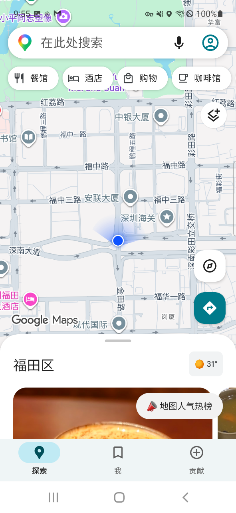

# Android 微信定位兼容性复核

日期：2026-10-21，Asia/Shanghai，约 09:47–09:54。结论：**当前系统模拟位置实现，在本次微信的位置选择页未生效**。这项结果与 Google Maps 的通过记录分别保存。

## 环境与初始状态

- 手机：Samsung SM-G990U2，Android 12 / API 31。
- CLocation：0.1.0；微信：8.0.79。
- 开始检查时 CLocation 已在持续模拟，前台定位服务存在，目标为公开测试坐标深圳 `22.543100, 114.057900`。
- 微信和 CLocation 均已有精确定位、粗略定位授权。
- UI 操作通过 mobile_mcp，系统定位与权限检查通过只读 ADB 诊断。报告不保存聊天内容、联系人、设备序列号或真实精确位置。

## 观测结果

| 检查项 | 结果 |
| --- | --- |
| 系统 GPS | 最新位置匹配深圳测试坐标，带 mock 标记 |
| 系统 network | 最新位置匹配深圳测试坐标，带 mock 标记 |
| 系统 fused | 最新位置匹配深圳测试坐标，带 mock 标记 |
| CLocation 后台运行 | 定位服务存在，复核期间坐标持续注入 |
| 微信系统请求 | 注册了定位请求；系统事件记录显示 GPS 和 passive 位置回调交付给微信 |
| 微信新开位置选择页 | 地图及附近地点仍显示实际位置区域，未变为深圳 |
| 微信页点击重新定位 | 仍显示实际位置区域；同期系统 provider 继续返回深圳 mock 坐标 |
| 同期 Google Maps | “我的位置”蓝点位于深圳福田区，与测试位置区域相符 |

本次排除了模拟未运行、切后台即停止以及缺少精确定位权限。**没有确定闭源微信内部究竟使用了哪项过滤策略或缓存路径**；系统记录回调交付不等于微信接受该结果。重新打开页面和点击重新定位仍未更新，也不能完全排除应用级或服务端缓存。

## 原因边界与技术依据

Android 标准模拟位置保留可供接收方识别的 mock 来源标记。[Android Location.isMock 文档](https://developer.android.com/reference/android/location/Location#isMock())

腾讯定位 SDK 的官方历史 FAQ 在“模拟GPS定位不起作用”条目中说明 SDK 会过滤模拟 GPS。[腾讯定位 SDK 历史 FAQ](https://tencentlocation.github.io/faq/tencent-location-sdk-faq.html)

该 FAQ 日期为 2015 年，说明过滤模拟位置是已存在的 SDK 行为，**不能单凭这份旧文档断言微信 8.0.79 的具体实现**。结合本次实测，mock 过滤、独立 Wi-Fi/基站网络定位及缓存均属于可能原因；不能通过再申请普通定位权限或坐标系换算承诺解决。

## 对项目的影响

- 既有“设置 A → Maps 观测 → 设置 B → Maps 观测 → 停止恢复”的单机验证仍成立。
- 本设备微信 8.0.79 的位置选择页兼容性记为“未生效”，不得宣称所有 App 定位都已改变。
- 若微信为必需目标，需要单独评估方案、设备约束与验收；当前公共系统模拟接口不能强制接收方使用结果。
- 本次没有更换用户已选的测试坐标或停止其原有模拟；结束时保留开始检查时的深圳模拟状态。

## 公开模拟位置截图

仅保存 Google Maps 的公开深圳测试点截图；微信显示真实区域的页面不进入仓库。

