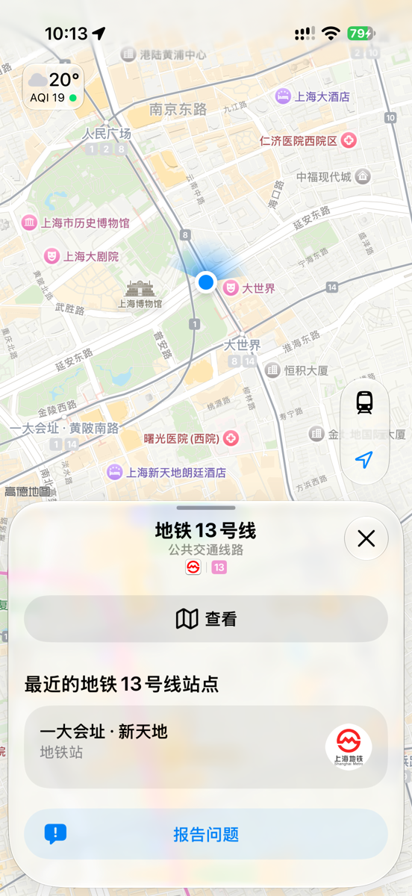
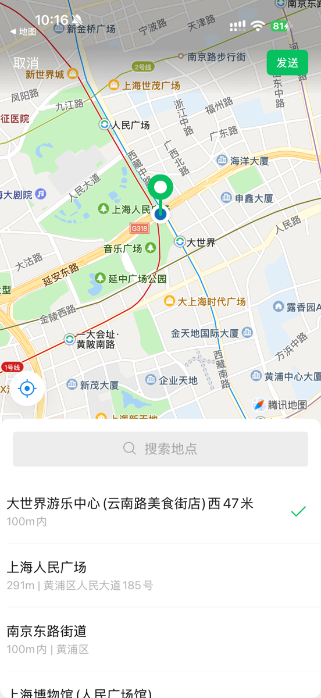
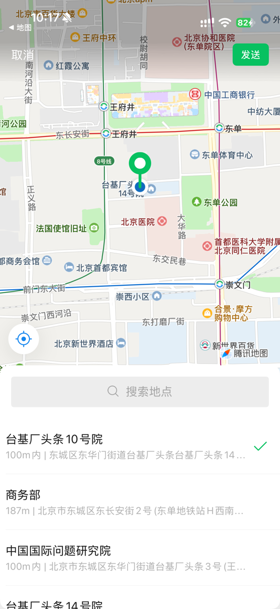
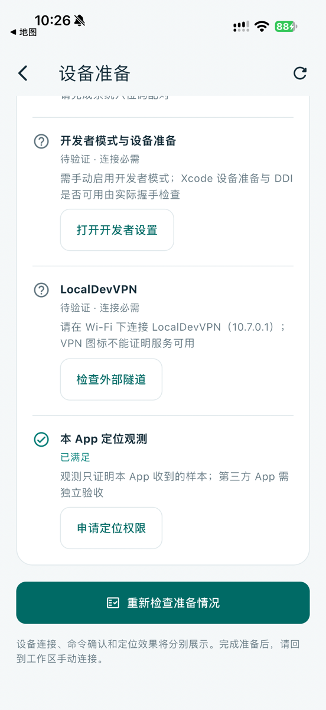

# iPhone 真机：Mac 辅助定位与微信验证

日期：2026-10-21，Asia/Shanghai，约 10:11–10:26。结论：**本次 Mac 直连开发者服务路线，在 iPhone 的苹果地图和微信位置选择页生效；清除后两者回到实际区域。CLocation 手机端独立设置链路仍待验收。**

后续更新：用户随后反馈安装 LocalDevVPN 后手机端测试成功，见 [用户反馈记录](2026-10-21-ios-user-feedback.md)。本页保留当时的工具测试和首次安装快照，下文“未完成”等表述指该次检查时的状态。

## 环境与方法

- iPhone 16 Pro，iOS 27.0.1 / build 24A446。
- 微信 8.0.79，bundle version 8.0.79.35。
- USB 连接 Mac，Xcode 27 工具链；系统开发者模式已开启，Mac 与设备已配对。
- UI 检查使用 mobile_mcp。首次安装其 iOS 测试代理 0.0.33，使用本机现有且包含该设备的开发描述文件。
- 设置与清除使用本机 `xcrun devicectl device simulate location`，不是 CLocation 的 idevice FFI，也不是 CLocation 本机 Remote Pairing。
- 只检查地图和微信的位置选择页，没有点击绿色“发送”，没有启动实时共享。未卸载、改签或替换微信。

## 结果

| 步骤 | 命令证据 | 独立观察 | 结论 |
| --- | --- | --- | --- |
| 基线 | 尚未设置本轮测试坐标 | 苹果地图蓝点位于实际区域 | 记录恢复比较基线；真实精确位置不入库 |
| 设置上海 `31.2304, 121.4737` | CLI 返回 `Set location to: 31.2304, 121.4737` | 苹果地图蓝点移动至上海；微信地图蓝点、位置标记及附近列表显示人民广场/大世界一带 | 上海点通过 |
| 设置北京 `39.9042, 116.4074` | CLI 返回 `Set location to: 39.9042, 116.4074` | 微信原页面起初保留上海；点击“我的位置”后，蓝点、位置标记及附近列表更新至北京王府井一带 | 北京点通过，页面需要刷新 |
| 清除 | CLI 返回 `Cleared location simulation` | 微信原页面短时间保留北京。随后苹果地图点击追踪回到实际区域；重新进入微信位置页后，地图和附近列表也回到实际区域 | 两个 App 的显示恢复通过；不能只凭 clear 返回即认定恢复 |

本次没有取得所有 App 的 Core Location 原始样本时间戳与来源标志；恢复结论限定为两个被观察页面回到基线区域，不等同于系统所有缓存或后台客户端都已完成恢复。没有测量严格恢复延迟。

命令模板如下，`<device-id>` 由设备枚举取得，不在报告保存真实标识：

```sh
xcrun devicectl device simulate location coordinate \
  --device <device-id> --latitude 31.2304 --longitude 121.4737 --timeout 30
xcrun devicectl device simulate location coordinate \
  --device <device-id> --latitude 39.9042 --longitude 116.4074 --timeout 30
xcrun devicectl device simulate location clear --device <device-id> --timeout 30
```

本机 CLI 帮助明确提示模拟持续到 clear。使用这一测试方法必须执行清除，并做独立恢复观察。

## CLocation 本身的真机状态

同轮已完成：

1. `flutter build ios --debug --no-pub`，使用项目已有开发团队自动签名，完整构建成功。
2. 将 `build/ios/iphoneos/Runner.app` 首次安装到该 iPhone。
3. `flutter run --no-pub --debug -d <device-id>` 启动成功，Dart VM 服务与工作台正常显示。Flutter 执行 Xcode 兼容迁移，包括 scheme 的 Flutter LLDB 初始化配置。
4. 允许本地网络、使用 App 时精确定位；无线数据选择“仅限无线局域网”。设备准备页显示 iOS 27.0.1、原生定位引擎已接入、定位观测权限已满足。

未完成：CLocation 的本机六位码配对、LocalDevVPN 隧道、App 内 idevice 认证握手与 set/clear。手机已安装应用枚举中未发现 LocalDevVPN；准备页仍显示本机配对待完成、隧道待验证。没有把 Mac 的既有配对记录导入 App，也没有用 Mac 命令替代 App 调用来宣称手机端验收通过。

后续要验证手机端独立操作，需准备 LocalDevVPN，完成 CLocation 本机配对，再由 App 执行相同的 A → B → 停止流程并观察微信。Mac 直连成功只提供该设备与该版微信存在有效模拟路线的证据，不能证明 App 内传输、配对或后台生命周期已可用。

结束时 Mac 模拟已清除，微信位置草稿已取消，前台为 CLocation 设备准备页。Flutter 调试会话已 detach；CLocation 和 mobile_mcp 测试代理保留安装，没有生成新的配对凭据。

## 截图

只保存公开模拟坐标和不含位置数据的准备页。真实区域、聊天内容、联系人和设备序列号不进入本报告或截图目录。








